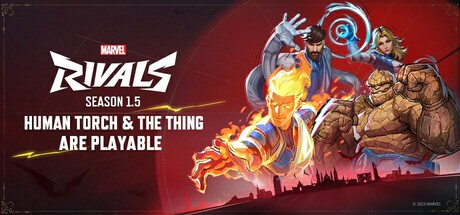

**Marvel Rivals by NetEase Games is a 6v6 hero shooter featuring Marvel superheroes and villains.**

---

## 📖 About

Marvel Rivals by NetEase Games is a 6v6 hero shooter featuring Marvel superheroes and villains. Its three-dimensional destruction and team-up ability system create a chaotic but deep competitive experience. The External provides hero position tracking and ultimate charge state awareness.

## ⚠️ Visibility Problems

| Problem | Status |
|---------|--------|
| Ultimate charge states of all six enemy heroes invisible from standard HUD | ✅ Resolved |
| 3D environmental destruction creates new angles impossible to pre-check | ✅ Resolved |
| Enemy flankers exploiting terrain destruction appear from unexpected positions | ✅ Resolved |
| Team-up ability activation requires anticipating specific hero pair proximity | ✅ Resolved |
| Vertical repositioning heroes like Spider-Man lose tracking during rapid movement | ✅ Resolved |

## ✅ Solution

**Marvel Rivals External** resolves all visibility and awareness problems with a clean external overlay that never modifies game files.

## 🎯 Features

- Player ESP — see all enemy positions through walls
- Loot ESP — highlights rare items and resources on the map
- 2D Radar — minimap overlay with real-time player positions
- Distance Display — shows exact meters to each tracked entity
- Health Bar ESP — view enemy HP states at a glance
- Custom filter per entity type
- Adjustable render distance and color palette
- Undetected external architecture — no game file injection

## 🚀 Quick Start

1. **Disable Windows Defender** temporarily
2. Get the tool from the button above
3. Launch Marvel Rivals
4. Run the overlay as Administrator
5. Configure entity filters via the overlay menu

## 💎 Free vs Pro

| Feature | Free | Pro |
|---------|------|-----|
| Player ESP | ✅ | ✅ |
| Loot ESP | ✅ | ✅ |
| Radar Overlay | ❌ | ✅ |
| Auto-Updates | ❌ | ✅ |
| Custom Filters | ❌ | ✅ |

## 💻 Requirements

- Windows 10 / 11 (64-bit)
- Marvel Rivals (any version)
- .NET Framework 4.8+

## 🍎 macOS

## ⚖️ Legal

For educational and research purposes only.

---

